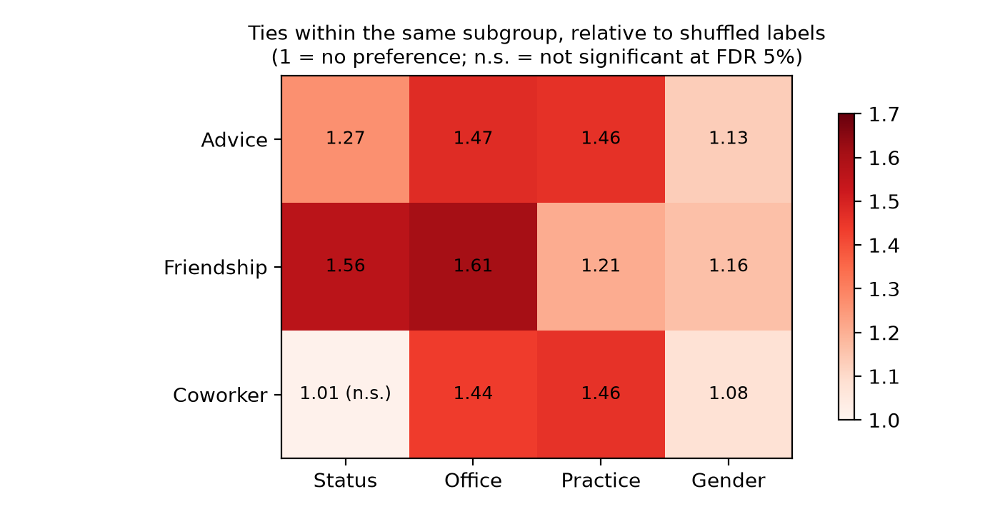
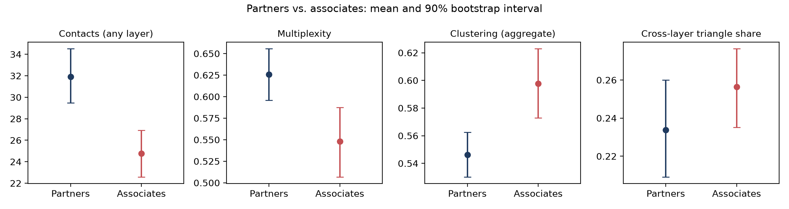
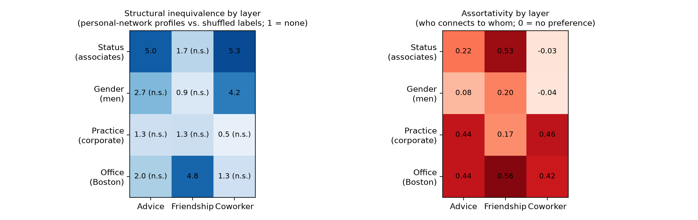
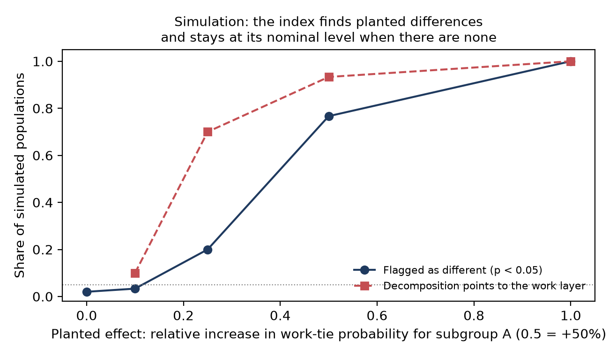

# Multilayer closure and subgroup structure in a social network

**Working paper (7 pages, PDF):** [Who Connects and How: A Null-Model Index of Structural Inequivalence Between Subgroups in Multilayer Social Networks](report/Multilayer_Inequivalence_Guilarte_Homayden.pdf)

A small, reproducible study of how social contexts overlap in a multilayer network and how network structure differs between subgroups, tested against null models, with a proposed **structural (in)equivalence index** validated by simulation on synthetic register-like populations. It uses **mlnlib**, the library developed for the Dutch population-scale network, and its **excess closure** measure, on a public multiplex network: the Lazega law firm.

## Questions

1. Do social contexts (advice, friendship, coworking) overlap more than each layer's degrees would imply?
2. Which attributes (status, office, practice, gender) organize which layer?
3. Does the structure of personal networks differ between subgroups, and is the difference larger than chance?
4. Which layer drives a structural difference between groups, and is that the same as segregation (who connects to whom)?
5. Does the index find planted differences, keep its false-positive rate, and scale to large populations?

## Data

- **Source:** Lazega law firm network (Lazega, 2001), from the Netzschleuder catalogue (`law_firm`, data hosted by Manlio De Domenico). File: `data/raw/network.csv.zip`.
- **Network:** 71 lawyers of a corporate law firm in New England, three layers. Directed nominations are symmetrized (a tie exists if either lawyer names the other): **advice 717, friendship 399, coworker 726** undirected ties.
- **Attributes:** status (36 partners, 35 associates), office (Boston 48, Hartford 19, Providence 4), practice (litigation 41, corporate 30), gender (53 men, 18 women).

## Method

1. **Multilayer network in mlnlib.** Each pair of lawyers stores its layers in one integer (binary encoding), the same format used for the population-scale network of the Netherlands.
2. **Node measures.** Degree (any layer); multiplexity (share of a lawyer's contacts linked in two or more layers); clustering on the aggregated network; **excess closure** (Bokányi et al., 2023, as implemented in mlnlib); and a bounded **cross-layer triangle share**: the share of a lawyer's closed triangles that no single layer closes on its own.
3. **Subgroup comparisons.** Difference in means for every subgroup and measure, with a 90% bootstrap interval (2,000 resamples of lawyers), a label-permutation test (10,000 permutations), and Benjamini–Hochberg correction across all comparisons.
4. **Null models.**
   - *Mixing:* the share of ties within the same subgroup, compared with networks in which attribute labels are shuffled (10,000 times, network fixed).
   - *Layer overlap:* each layer is rewired independently with degree-preserving edge swaps (500 times), so every lawyer keeps its number of contacts in each layer but the layers lose their alignment.

## Results

**Social contexts overlap far more than chance.** 60% of ties are multiplex, against 32% when layers are rewired independently (z = 28.7); mean excess closure is 1.34 against 0.98. Because the same people meet across advice, friendship, and work, most triangles close within a single layer: only 24% of triangles need more than one layer to close, against 62% if layers were independent.

| Measure | Observed | Rewired layers (mean, 90% range) |
|---|---|---|
| Multiplex ties | 0.60 | 0.32 (0.31–0.34) |
| Excess closure (mlnlib) | 1.34 | 0.98 (0.97–0.99) |
| Cross-layer triangle share | 0.24 | 0.62 (0.61–0.64) |

**Status organizes friendship, not work.** Friendship ties stay within the same status 1.56 times as often as with shuffled labels, while coworker ties show no status preference (1.01, not significant). Office organizes all three layers (1.44–1.61 times), and practice organizes advice and coworking (1.46) more than friendship (1.21).



**Associates have smaller, more closed personal networks.** Associates have fewer contacts than partners (24.8 vs. 31.9; q = 0.02), a lower share of multiplex ties (0.55 vs. 0.63; q = 0.08), and higher clustering (0.60 vs. 0.55; q = 0.08). Partners' ties are more numerous and span more contexts at once. Office size also matters: lawyers in Boston, the largest office, have more contacts (q = 0.05).



**A note on the measure.** In this small, dense network the multiplicity-weighted clustering in mlnlib exceeds 1 (mean 1.26), so excess closure also exceeds 1. The measure was designed for large, sparse register networks; in dense networks it remains useful for comparisons against a null model, and the bounded cross-layer triangle share gives a complementary reading on a 0–1 scale.

## Structural (in)equivalence between subgroups (step 5)

**Index.** Each lawyer is described by a multilayer profile: degree in each layer, multiplexity, aggregate clustering, and cross-layer triangle share. Two groups are structurally equivalent if their profile distributions are the same. The index is the multivariate energy distance between the standardized profiles of a group and the rest (Székely and Rizzo, 2013), reported relative to its mean under shuffled labels (1 = no difference), with a permutation p-value and Benjamini–Hochberg correction. A **layer decomposition** computes the same index on one layer's degree and clustering at a time. It is compared with **attribute assortativity** in each layer, the measure used for socio-economic segregation in the Dutch population-scale network (Kazmina et al., 2024).

| Subgroup vs. rest | Inequivalence (× shuffled) | q | Layer driving it |
|---|---|---|---|
| Associates | 3.7 | 0.001 | advice (5.0) and coworking (5.3), not friendship (1.7, n.s.) |
| Men | 2.2 | 0.03 | coworking (4.2) |
| Boston office | 2.0 | 0.04 | friendship (4.8) |
| Corporate practice | 1.3 | 0.22 (n.s.) | none |

**Segregation and structural inequivalence are different things.** Practice is strongly assortative in advice and coworking (0.44–0.46), yet corporate and litigation lawyers have equivalent personal-network profiles. Gender is not assortative in coworking (−0.04), yet men's coworking networks differ in shape from women's (4.2 times shuffled labels). Status shows the reverse split across layers: it organizes *who befriends whom* (assortativity 0.53), while partners and associates differ most in the *shape* of their advice and work networks. A measure of group differences therefore needs both views: whom people connect to, and what their personal networks look like.



## Validation by simulation and scaling (step 6)

Synthetic register-like populations of 1,000 people with four layers (household, family, work, neighbors; 30% in subgroup A). A planted effect raises the tie probability among subgroup A's colleagues; with no effect, A and B are structurally identical by construction.

| Planted effect (increase in work-tie probability) | Runs | Flagged (p < 0.05) | Median inequivalence | Decomposition points to work |
|---|---|---|---|---|
| none | 100 | 2% | 0.92 | – |
| +10% | 30 | 3% | 0.93 | 10% |
| +25% | 30 | 20% | 1.25 | 70% |
| +50% | 30 | 77% | 2.04 | 93% |
| +100% | 30 | 100% | 3.44 | 100% |

The index keeps its false-positive rate below the nominal 5% when groups are equivalent, detects moderate differences, and its layer decomposition locates the layer where the difference was planted.



**Scaling.** On synthetic populations of 10,000 and 100,000 people (45,524 and 455,426 ties), generation took 0.6 and 5.7 seconds, mlnlib excess closure for 5,000 sampled egos took 0.1 and 0.3 seconds, and the inequivalence test on a sample of 2,000 people took about 3 seconds in both cases. Because the test runs on samples of egos, its cost does not grow with population size; at national scale the binding cost is building the network, which mlnlib already handles for the full Dutch population.

## Limitations

- One firm of 71 lawyers, observed once: the results describe this network, not law firms in general.
- Symmetrizing nominations discards direction, which matters for advice (who asks whom).
- Providence has only 4 lawyers, so its comparisons have little power.
- The rewiring null keeps each lawyer's degree in each layer but nothing else (for example, office composition), so part of the overlap may reflect shared offices.
- The energy-distance index detects any difference in profile distributions; it does not say which direction or which feature without the decomposition, and its power depends on group sizes (the Providence office, n = 4, is a stress case).
- The synthetic populations are stylized: block sizes and tie probabilities are illustrative, not calibrated to Dutch registers.

## What this suggests for population-scale networks

Comparing groups requires two complementary measures: assortativity (whom people connect to) and structural inequivalence (what their personal networks look like), each against a null model and decomposed by layer. Because the inequivalence index is defined relative to shuffled labels and runs on samples of egos, it can be applied to any subgroup of a register-based network and compared across countries whose registers define layers differently.

## Reproduce

```bash
pip install -r requirements.txt
cd src
python step1_build_mln.py      # builds the mlnlib network from data/raw/network.csv.zip
python step2_closure.py        # node measures and subgroup comparisons
python step3_null_models.py    # mixing and layer-overlap null models (about 2 minutes)
python step4_figures.py
python step5_structural_inequivalence.py   # inequivalence index, layer decomposition, assortativity
python step6_simulation.py validation      # simulation study (about 9 minutes); reported results come from this full run
python step6_simulation.py scaling
python step7_figures_inequivalence.py
```

## References

- Benjamini, Y., and Hochberg, Y. (1995). Controlling the false discovery rate: a practical and powerful approach to multiple testing. *Journal of the Royal Statistical Society: Series B*, 57(1), 289–300.
- Bokányi, E., Heemskerk, E. M., and Takes, F. W. (2023). The anatomy of a population-scale social network. *Scientific Reports*, 13, 9209.
- Bokányi, E., Kazmina, Y., Heemskerk, E. M., and Takes, F. W. (2026). Fragmentation of a longitudinal population-scale social network: Decreasing structural social cohesion in the Netherlands. arXiv:2602.00234.
- Kazmina, Y., Heemskerk, E. M., Bokányi, E., and Takes, F. W. (2024). Socio-economic segregation in a population-scale social network. *Social Networks*, 78, 279–291.
- Lazega, E. (2001). *The Collegial Phenomenon: The Social Mechanisms of Cooperation Among Peers in a Corporate Law Partnership*. Oxford University Press.
- mlnlib: https://github.com/planet-nl/mlnlib
- Székely, G. J., and Rizzo, M. L. (2013). Energy statistics: A class of statistics based on distances. *Journal of Statistical Planning and Inference*, 143(8), 1249–1272.

Author: Eugenio Guilarte Homayden
